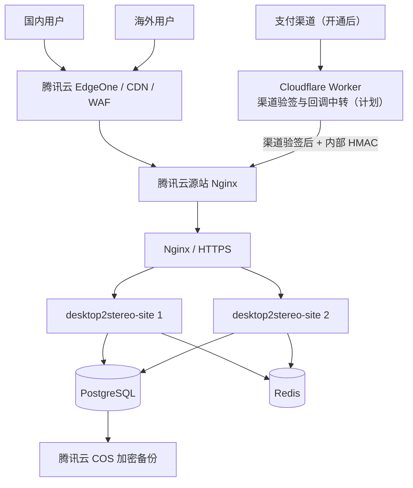

# d2s.site 服务端部署与运维方案

## 1. 文档定位

本文是 `desktop2stereo-site` 的唯一部署基准，合并原 `d2s.site` 网站架构方案与
Desktop2Stereo 授权服务部署要求。服务器端开发计划见
[`01-cross-platform-licensing-server-implementation-plan.md`](01-cross-platform-licensing-server-implementation-plan.md)。
上线前与季度恢复演练按 [`d2s-production-drill.md`](d2s-production-drill.md) 执行。

生产原则是“腾讯云承载权威状态，腾讯云 EdgeOne 提供网站边缘加速与防护；支付回调桥仅在支付渠道实际开通后启用”：

- PostgreSQL 中的账号、订单、账务和授权记录是唯一权威状态。
- Redis 只用于会话、限流、缓存和多节点协调，不保存最终授权事实。
- EdgeOne 只提供公网边缘服务，不保存授权权威状态，也不直接修改订单或授权。
- SQLite 仅用于本地开发；生产使用 PostgreSQL，MySQL 是受支持的替代方案。
- SQLite 的 D2S 写事务对短暂的 `database is locked/deadlocked` 进行有限重试；这只提高本地开发并发稳定性，生产仍必须使用 PostgreSQL 或 MySQL。

无管理员权限的 Windows 开发机可使用仓库外的 `.local-db` 便携实例运行真实数据库矩阵：

```powershell
.\scripts\d2s-local-db-install.ps1 -Start
.\scripts\d2s-local-db.ps1 -Action init
$env:D2S_TEST_POSTGRES_DSN = 'host=127.0.0.1 port=5433 user=d2s_test password=<local-password> dbname=d2s_test sslmode=disable'
$env:D2S_TEST_MYSQL_DSN = 'd2s_test:<local-password>@tcp(127.0.0.1:3307)/d2s_test?charset=utf8mb4&parseTime=True&loc=Local'
go test ./model -run 'TestD2SSchemaConfiguredDatabases|TestD2SConcurrentCriticalPaths' -count=1 -v
.\scripts\d2s-local-db.ps1 -Action stop
```

首次使用先执行 `d2s-local-db-install.ps1 -Start`。脚本从 PostgreSQL 和 MySQL 官方 HTTPS
下载地址获取固定版本，安装到工作区外的 `.local-db`，初始化数据目录后可选启动两个实例；
已存在的压缩包、程序和数据目录会复用，不注册 Windows 系统服务。`.local-db`、下载缓存和
数据库文件不进入 Git。360 等安全软件应信任固定的 `.local-db` 目录以及下方列出的 Go 测试目录。

`init` 会幂等创建本地 `d2s_test` 数据库、测试用户和授权；默认测试密码为 `d2s_test`。
如需自定义密码，在当前 PowerShell 进程设置 `D2S_LOCAL_DB_TEST_PASSWORD`，MySQL root 和
PostgreSQL superuser 密码分别使用 `D2S_LOCAL_MYSQL_ROOT_PASSWORD` 与
`D2S_LOCAL_POSTGRES_PASSWORD` 注入，密码不会写入脚本或仓库。

该脚本只管理 `127.0.0.1:5433` 和 `127.0.0.1:3307` 的便携进程，不注册 Windows 系统服务；`.local-db/` 已加入忽略规则，不能用于生产部署。

如果 Windows 杀毒软件拦截 Go 测试程序，不要信任 Go 默认生成的动态 `%TEMP%\go-build*` 目录，改用固定路径测试脚本：

```powershell
.\scripts\d2s-fixed-go-test.ps1
```

建议将以下固定目录加入信任列表：

- `E:\AI_2D_to_3D\4.LC700X_Desktop2Stereo\.go-test-binaries`
- `E:\AI_2D_to_3D\4.LC700X_Desktop2Stereo\.go-build-cache-d2s`
- `E:\AI_2D_to_3D\4.LC700X_Desktop2Stereo\.go-tmp-d2s`

脚本默认验证 `controller`、`model`、`service` 和 `router`，并把最终测试可执行文件固定输出到 `.go-test-binaries`。

前端 Vitest 测试使用固定路径脚本，避免 Node/Vite 回落到系统临时目录：

```powershell
.\scripts\d2s-fixed-web-test.ps1 src/features/d2s/__tests__ src/routes/__tests__/device.test.tsx
```

脚本使用以下固定目录：

- `E:\AI_2D_to_3D\4.LC700X_Desktop2Stereo\.web-cache-d2s`
- `E:\AI_2D_to_3D\4.LC700X_Desktop2Stereo\.web-tmp-d2s`

Go 或前端工具在固定父目录内部生成的编译子目录仍可能带工具链生成的名称；360 应信任上述固定父目录，而不是只信任某一次生成的子目录或可执行文件。

## 2. 生产拓扑



首发可在一台腾讯云 CVM 上运行应用、Nginx、PostgreSQL 和 Redis，但数据库与 Redis
端口不得暴露公网。业务增长后，将数据库迁到托管实例，并通过 CLB 扩展到至少两个应用
容器。所有应用节点必须共享数据库、Redis、会话 Secret、授权签名私钥和支付桥 Secret。

## 3. 域名、网络与 TLS

- 当前服务域名为 `d2s.site` 与 `d2s.top`，负责人确认两者承载相同功能；ICP备案号分别为 `鲁ICP备2026064880号-1`（d2s.site）和 `鲁ICP备2026064880号-2`（d2s.top）。
- 负责人确认网站使用腾讯云 EdgeOne 提供边缘加速/防护。2026-11-04 公网观察到 d2s.site 的 DNS CNAME 指向 EdgeOne，d2s.top 的响应头显示直接到达源站 Nginx；域名解析和控制台策略仍应以腾讯云配置核验。
- 生产源站系统 Nginx 配置位于 `/etc/nginx/sites-enabled/d2s.site`，`server_name` 包含 d2s.site、www.d2s.site、d2s.top、www.d2s.top，并反代到 `127.0.0.1:3000`。该站点配置不在宝塔 `/www/server/panel/vhost/nginx` 目录中维护。
- 2026-11-04 只读诊断：源站用固定回环和正确 Host/SNI 请求 `/api/status`、`/api/v1/support/config`、`/business-license.png` 均为 200；公网 d2s.top 的两个 API 连续 4 次为 200，但公网 d2s.site 经 EdgeOne 的 `/api/status`、`/api/v1/support/config` 连续 4 次为 404，`/business-license.png` 也为 404。应用源站资源正常，故障已缩小到 d2s.site 的 EdgeOne/边缘转发路径，需核验 EdgeOne 源站、回源 Host/SNI 与路径转发规则。检查未修改生产配置。
- 2026-11-04 再次无凭据只读 GET：d2s.site 的 `/api/status`、`/api/privacy-policy`、`/api/v1/support/config` 均为 404；d2s.top 的对应接口均为 200，但隐私政策 `data` 仍为空，客服配置正常。负责人将核对 EdgeOne 源站地址、回源 Host 和回源协议；收到这三项配置前不修改边缘或生产配置。
- 2026-11-04 在生产源站 SSH 会话中执行回源对照：`hk-source.callback.cloudses.com` 解析至 `43.129.115.212`，其响应头标识 Tencent SES `SesCallback` RPC 服务；使用该地址时 A（Host 同源站域名）=404、B（Host `www.d2s.site`）=404、C（HTTP 80）=308。该地址不是网站源站。`d2s.top` 解析至 `118.89.79.159`；以 `d2s.site`/`www.d2s.site` 为 TLS SNI 并直连该地址，严格证书校验通过，`/`、`/api/status`、`/api/privacy-policy`、`/api/v1/support/config`、`/business-license.png` 均为 200。网站 EdgeOne 源站候选应为 `118.89.79.159`（或经核实指向该 IP 的源站域名），回源 Host 建议 `d2s.site`，回源协议 HTTPS/443。未修改 EdgeOne 或生产配置；隐私政策接口虽为 200，内容仍为空。
- 2026-11-04 按负责人补充的实际源站 80 端口探测：在源站机执行 `curl http://118.89.79.159/ -H 'Host: www.d2s.site'` 返回 301，`Location: https://www.d2s.site/`；`/api/status` 同样返回 301。源站 80 强制跳 HTTPS，不满足协议跟随下两种协议直接返回业务内容的条件。回源固定 HTTPS/443 可用且严格 TLS 已验证，建议选择 HTTPS 回源以避免 HTTP 重定向往返。未改生产配置。
- 2026-11-04 负责人报告 EdgeOne 回源修复后，无缓存 GET 复验 `d2s.site` 与 `d2s.top` 的 `/api/status`、`/api/v1/support/config` 均为 200；运行版本为 `d11d0cc1da5070bc65b57ff72181ed2865043833`。两个域名的 `/api/privacy-policy` 返回 200 但 `data` 为空，状态接口的 `privacy_policy_enabled` 为 false。`/business-license.png` 虽返回 200，但 Content-Type 是 `text/html` 且正文为 SPA 回退页；生产 SHA `d11d0cc1da5070bc65b57ff72181ed2865043833` 的 Git 树不含该 PNG。当前工作树已新增 `/business-license` 展示页并将首页链接改为站内路由，生产需在新版本发布后复验页面和 PNG 内容类型。
- HTTPS 与源站证书应覆盖上述域名；源站 HTTP 仅跳转 HTTPS。正式修复前，不能把 EdgeOne 返回 404 描述成应用路由缺失，也不能将 d2s.top 直连状态视为完成了同等边缘防护。
- 数据库 5432/3306 和 Redis 6379 只允许应用子网访问。
- Nginx 只信任实际负载均衡/代理地址传入的客户端 IP；`TRUSTED_PROXIES` 不得配置为全网。

## 4. 支付回调链路

支付渠道回调地址指向 Cloudflare Worker。Worker 或源站渠道适配器必须先按渠道官方规则验证
签名、时间戳和重放条件，再把规范化事件转发到：

`POST https://d2s.site/api/v1/webhooks/{provider}`

转发请求使用与渠道 Secret 分离的 `D2S_PAYMENT_BRIDGE_SECRET[_PROVIDER]` 生成
`X-D2S-Signature`；例如 Stripe 使用 `D2S_PAYMENT_BRIDGE_SECRET_STRIPE`。服务端优先使用
渠道专用 Secret，未配置时才回退到全局 Secret，再次校验订单、渠道、区域、金额和币种，并通过
`(provider, provider_event_id)` 幂等处理。Worker 不能直接写数据库，也不能仅依靠来源 IP
证明回调可信。建议再用 Cloudflare Access 服务令牌或 mTLS 限制桥接入口。

当前 Go 服务也提供已验签渠道的直接适配入口：Stripe、Creem、易支付、支付宝电脑网站支付、Waffo 和 Waffo
Pancake 回调在本地完成官方验签后进入同一 D2S 事件处理器；这不改变通用桥接接口的用途。
PayPal/Paddle 在完成适配器前不开放。

必须在渠道沙箱覆盖：成功、重复、乱序、延迟、取消、伪造、金额不符、币种不符和拒付。

日终由管理员调用 `GET /api/v1/admin/reconciliation`（可传 UTC Unix `start_at`/`end_at`）
导出内部订单与支付事件报告，再与各渠道结算文件逐笔核对。报告中的过期待支付、孤立事件、
订单/事件金额或币种不一致必须在放量前处理；该接口不会自动修改订单或账本。

生产服务器使用固定路径的 systemd timer 每天 02:15 UTC 执行对账。安装仓库中的
`deploy/desktop2stereo-reconciliation.sh` 到 `/usr/local/sbin/desktop2stereo-reconciliation`，
并创建 root-only 的 `/etc/desktop2stereo/reconciliation.env`：

```text
D2S_RECONCILIATION_BASE_URL=https://d2s.site
D2S_RECONCILIATION_ROOT=/opt/desktop2stereo-site
D2S_RECONCILIATION_REPORT_ROOT=/opt/desktop2stereo-site/reconciliation-reports
D2S_RECONCILIATION_TOKEN=<32-byte-hex-secret>
```

在应用 `.env` 中配置同一个 `D2S_RECONCILIATION_TOKEN`，通过 Compose 传给服务；应用 `.env` 使用 `0600` 权限且不得提交到 Git。令牌必须由 `openssl rand -hex 32` 生成，不能复用后台管理员密码。systemd 环境文件使用 `root:root` 和 `0600` 权限。只有新版服务已部署并通过人工调用验证后才启用 timer。

再安装并启用：

```bash
install -o root -g root -m 0750 deploy/desktop2stereo-reconciliation.sh \
  /usr/local/sbin/desktop2stereo-reconciliation
install -d -o root -g root -m 0700 /etc/desktop2stereo
install -d -o root -g root -m 0700 /opt/desktop2stereo-site/reconciliation-reports
install -o root -g root -m 0644 deploy/desktop2stereo-reconciliation.service \
  /etc/systemd/system/desktop2stereo-reconciliation.service
install -o root -g root -m 0644 deploy/desktop2stereo-reconciliation.timer \
  /etc/systemd/system/desktop2stereo-reconciliation.timer
systemctl daemon-reload
systemctl enable --now desktop2stereo-reconciliation.timer
```

报告固定保存到 `/opt/desktop2stereo-site/reconciliation-reports/`，同一 UTC 日期的已有报告
不会被覆盖。存在差异时脚本以非零状态退出，`systemctl status`、journal 和服务器监控可据此
告警；脚本不会输出管理员令牌，也不会自动修改订单或账本。

## 5. 必需配置

基础配置：

- `SQL_DSN`：生产 PostgreSQL 或 MySQL 连接串。
- `REDIS_CONN_STRING`：生产 Redis 连接串。
- `SESSION_SECRET`：所有节点一致的高熵 Secret。
- `SESSION_COOKIE_SECURE=true`。
- `SESSION_COOKIE_TRUSTED_URL=https://d2s.site`。
- `TRUSTED_PROXIES`：实际 CLB、Nginx 或 Tunnel 网络范围。

系统初始化通过受控部署创建、角色为 root 且未绑定邮箱的所有者管理账号，可使用原管理员密码登录系统后台；该管理登录不会填写邮箱验证时间，也不会激活购买、下载授权或试用资格。普通账户以及已填写但尚未验证邮箱的 root 账户仍须先完成邮箱验证；账户紧急登录限制对初始化 root 同样生效。

授权与商业配置：

- `D2S_PURCHASES_ENABLED=false`：服务端购买和下单总开关，默认关闭；关闭时订单预览、创建、结账以及付费解绑、离线延长等付费订单入口返回 503，支付渠道发现接口返回空列表。前端同步隐藏支付渠道、禁用购买选项并提示暂未开放。生产环境应明确保持 `false`；只有支付沙箱、合规审查和端到端验收完成后，才可显式设为 `true`。
- 支付宝电脑网站支付的 App ID、Seller ID、网关、通知/返回地址、RSA2 商户私钥和支付宝公钥由普通系统后台 root 管理员在“系统设置 → 计费设置 → 支付网关 → 支付宝”中维护；私钥和支付宝公钥以 AES-GCM 加密后存入配置表，读取 API 不返回密钥，审计只记录变更字段。加密依赖稳定的 `CRYPTO_SECRET`（未单独配置时使用稳定的 `SESSION_SECRET` 派生）；轮换该 Secret 前必须先迁移并重新加密支付宝密钥，否则旧密文无法解密。后台也支持切回服务器环境变量配置：`D2S_ALIPAY_PC_ENABLED`、`D2S_ALIPAY_APP_ID`、`D2S_ALIPAY_SELLER_ID`、`D2S_ALIPAY_PRIVATE_KEY_PEM`、`D2S_ALIPAY_PUBLIC_KEY_PEM`、`D2S_ALIPAY_NOTIFY_URL`、`D2S_ALIPAY_RETURN_URL`，`D2S_ALIPAY_GATEWAY_URL` 可选，默认正式网关。`D2S_ALIPAY_PUBLIC_KEY_PEM` 必须是支付宝公钥，不能填商户应用公钥。沙箱请按支付宝控制台选择 OpenAPI 沙箱网关（如 `https://openapi-sandbox.dl.alipaydev.com/gateway.do`）和对应密钥，不能使用旧国际 MAPI 网关，也不能混用正式与沙箱凭据。后台的支付宝渠道开关、购买总开关 `D2S_PURCHASES_ENABLED` 和支付合规确认是独立门禁，配置表单不会绕过后两者。支付宝电脑网站支付由后台设置二维码展示模式（0、1、3、4），支付表单在本站页面的支付宝 iframe 中打开；模式 4 的二维码宽度由服务端固定。

电脑网站支付的结果通知地址通过支付请求中的 `notify_url` 传入，本站地址为 `https://d2s.site/api/v1/alipay/d2s/notify`。开放平台“应用网关”为 `https://d2s.site/api/v1/alipay/app-gateway`，GET 用于 HTTPS 可访问性检测，POST 仅验签并处理已支持的电脑网站支付通知；它与每笔请求的 `notify_url` 分开配置，其他支付宝产品仍未启用。

支付宝电脑网站支付对照[官方接入指南](https://ideservice.alipay.com/cms/site/0izbjt)的检查状态（仅针对本站自营软件付款）：

| 环节 | 当前实现与验收要求 |
| --- | --- |
| 发起支付 | 已生成 `alipay.trade.page.pay` POST 参数，使用 RSA2；请求签名包含 `sign_type`。`out_trade_no` 使用 `D2S` 加 UUID 的 32 位十六进制字符，符合字符限制；金额取服务端订单快照，`time_expire` 与订单截止时间一致。 |
| 异步通知 | 已按支付宝通知规则验签（排除 `sign`、`sign_type`），核对 `app_id`、`auth_app_id`、配置的 `seller_id`、订单号、金额及订单渠道；重复同一通知只结算一次。关闭新购买入口后仍可接收已创建订单的有效通知。同步 `return_url` 不触发履约。 |
| 未收到通知、订单超时 | 已接入经 RSA2 响应验签和身份/金额校验的 `alipay.trade.query` 主动对账。主节点每分钟扫描未完成订单；过期订单先调用 `alipay.trade.close`，仅在支付宝确认关闭后取消本站订单并释放余额预留。通用过期任务会跳过支付宝订单。 |
| 退款、关单、账单 | 已增加超级管理员退款、主动关单及按日期下载交易账单 API。退款使用幂等号和待核状态，部分退款保留授权，确认全额退款后停用授权；账单即时透传、不在本站存档。后台配置表单已加入代码，尚需部署后填写生产参数；真实支付和退款验收仍待完成。 |
| 验收 | 商户应用权限与正式密钥配置、支付宝沙箱支付及签名失败/金额不符/重复通知/通知丢失/过期订单/部分退款/全额退款/账单下载测试仍是生产门禁。购买开关必须保持关闭，直到沙箱与生产等价环境验收完成。 |

- `D2S_DEVICE_VERIFICATION_URI=https://d2s.site/device`。
- `D2S_LICENSE_KEY_ID`；未显式设置时默认为客户端当前内置公钥对应的
  `d2s-es256-2026-09`，生产环境必须确保该 ID 与配置的 P-256 私钥匹配。
- `D2S_LICENSE_PRIVATE_KEY_B64`，内容为 P-256 PKCS#8 DER 私钥的 Base64；运行时也兼容
  Base64 编码的 PEM，以便平滑迁移既有部署。
- 生产 Docker/宝塔部署将私钥保存于部署目录 `.env`（当前服务器为
  `/opt/desktop2stereo-site/.env`），文件权限必须为 `600`；也可以在宝塔 Docker 项目的环境变量
  中设置同名变量。该私钥不应写入数据库、Git、客户端或后台网页表单，后台签名密钥接口只管理
  公钥元数据和轮换状态。
- `D2S_PARALLAX_CORE_SHA256`：私有核心仓库中加密视差资源的 SHA-256，必须与发布资源完全一致。
  当前受保护视差核心资源版本的值为
  `ce18716f3dbd9728aab595812a2746367be667e76a0024bb117b03a2d1d2016a`；核心资源更新后必须同步轮换该环境变量。
- `D2S_PARALLAX_CORE_KEY_HEX`：加密视差资源对应的 AES-256 密钥，只能通过生产部署 Secret 注入，
  不得写入公开仓库、客户端或后台网页表单。
- `D2S_PAYMENT_BRIDGE_SECRET`；推荐按渠道配置 `D2S_PAYMENT_BRIDGE_SECRET_STRIPE`、
  `D2S_PAYMENT_BRIDGE_SECRET_CREEM`、`D2S_PAYMENT_BRIDGE_SECRET_EPAY`、
  `D2S_PAYMENT_BRIDGE_SECRET_PAYMENTFM`、`D2S_PAYMENT_BRIDGE_SECRET_ALIPAY`、
  `D2S_PAYMENT_BRIDGE_SECRET_WECHAT`、`D2S_PAYMENT_BRIDGE_SECRET_WAFFO` 和
  `D2S_PAYMENT_BRIDGE_SECRET_WAFFO_PANCAKE`，渠道专用值优先于全局值。
- `D2S_OFFLINE_EXTENSION_CNY_MINOR=1990`（¥19.90）；`D2S_OFFLINE_EXTENSION_USD_MINOR=299`（$2.99）。价格以最小货币单位配置，运行时校验必须为正整数。

部署前运行 `scripts/d2s-production-readiness.ps1 -RequireSecrets` 时，脚本会检查非超级用户应用 DSN、独立审计迁移/清理 DSN 已配置并实际解析签名私钥，
确认其包含私有标量且为有效 P-256 密钥，并拒绝错误 ASN.1、损坏密钥、仅公钥材料或非 P-256 曲线；还会校验离线延长
价格为正整数，并拒绝 `0.0.0.0/0`、`::/0`、`*` 或 `all` 这类全网信任代理配置；
`TRUSTED_PROXIES=none` 只能单独使用；会话 Secret 和支付桥 Secret 至少需要 32 个字符。
`-BaseUrl` 必须是没有凭据、路径、查询串或片段的 HTTPS origin。Cookie 信任源和设备验证
URL 还必须使用 BaseUrl 主机或其子域名，并匹配端口；脚本会拒绝 URL 凭据。即使使用
`-SkipHttp`，这些静态配置校验仍会执行。启用 HTTP 检查并同时传入 `-RequireSecrets` 时，还会确认 `/api/v1/license/keys`
发布的 ES256 公钥 `kid`、`x`、`y` 与配置的 `D2S_LICENSE_KEY_ID` 和 P-256 私钥完全一致，
避免密钥 ID 相同但密钥对错配后误判通过；不传 `-RequireSecrets` 时只校验健康端点及公开密钥 ID。

审计表迁移与权限：

- PostgreSQL/MySQL 首次部署或升级审计表时，使用独立迁移身份设置 `D2S_AUDIT_MIGRATION_DIALECT` 和 `D2S_AUDIT_MIGRATION_DSN`；迁移 DSN 必须指向与 `D2S_APP_SQL_DSN` 相同的数据库和 schema。Docker 发布流程在专用 maintenance profile 临时容器中运行随镜像编译的 `/d2s-audit-migrate`；迁移 DSN 不传入长期运行的应用容器。`D2S_APP_SQL_DSN` 使用非超级用户 `d2s_app`，对审计表只具有 SELECT/INSERT。
- 迁移完成后，由数据库管理员执行 `deploy/d2s-audit-permissions.postgresql.sql` 或 `deploy/d2s-audit-permissions.mysql.sql`，按实际数据库、schema 和账户调整占位符，并核对脚本结果。PostgreSQL 脚本检查有效表权限、列级 UPDATE、TRUNCATE 和清理身份的额外写权限；MySQL 必须检查 `SHOW GRANTS` 和继承角色，确认没有更宽的全局或数据库授权覆盖表级限制。
- PostgreSQL Docker 更新器每次切换应用前，在同一 maintenance profile 中顺序执行角色/业务表归属准备、审计表迁移和权限脚本；任一步失败都会停止更新并保留正在运行的版本。`POSTGRES_USER`/`POSTGRES_PASSWORD` 只提供给短生命周期的数据库维护容器，不传给应用容器。首次部署须先为三个独立角色配置随机密码，并配置 `D2S_APP_SQL_DSN`、`D2S_AUDIT_MIGRATION_DSN`、`D2S_AUDIT_CLEANUP_DSN`。
- Docker Compose 将 `D2S_AUDIT_CLEANUP_DSN` 传给应用用于受控清理；该 DSN 应连接相同数据库和 schema，并使用独立清理身份。缺少审计表时，MySQL/PostgreSQL 服务启动会失败；清理 DSN 未配置时，受控清理接口返回不可用且不会删除数据。
- SQLite 开发环境仍由应用自动迁移，SQLite 不提供表级账户权限，不能据此声称生产权限隔离已经落实。

同时在 new-api 管理设置中启用邮箱验证、SMTP、支付合规确认和实际使用的支付渠道。
登录/注册使用服务端自托管点击验证码；邮箱验证码、密码重置和其他仍接入 Turnstile
的入口，只有在对应接口完成迁移并验证后才能关闭 Turnstile。生产 Secret 只能进入腾讯云
Secret 管理、受限环境变量或编排系统 Secret，不能写入仓库、镜像、数据库、日志和客户端。

## 6. 首次部署

1. 创建腾讯云 CVM/VPC、安全组、PostgreSQL、Redis 和 COS 备份桶。
2. 将 `d2s.site` 接入 Cloudflare，配置严格 TLS、WAF、限流和源站连接。
3. 克隆本仓库并从 `.env.example` 创建生产 Secret 配置。
   至少设置 `POSTGRES_PASSWORD` 和 `REDIS_PASSWORD`；生产 Compose 不再提供数据库或 Redis
   密码默认值，执行 `docker compose config` 可提前检查变量是否齐全。
4. 先确认 Go 没有被旧的代理覆盖，并使用官方模块代理和校验服务；这不改变 `go.mod`，也不绕过模块校验：

   ```bash
   go env -u GOPROXY
   go env -u GOSUMDB
   go env GOPROXY GOSUMDB
   go mod download
   go mod verify
   ```

   也可以使用仓库内脚本执行上述检查；脚本只修改当前 PowerShell 进程的环境变量，不会污染全局 Go 配置：

   ```powershell
   .\scripts\d2s-go-deps.ps1
   ```

   只有部署机到官方服务的链路确实超时，才显式允许临时切换镜像；当前项目默认不使用镜像：

   ```powershell
   .\scripts\d2s-go-deps.ps1 -AllowMirrorFallback
   ```
5. 构建当前源码，不能直接使用未包含 D2S 扩展的上游镜像：

   ```bash
   docker compose build --pull
   docker compose up -d
   docker compose ps
   ```

6. 完成 new-api 初始化，启用邮箱验证和支付渠道；按接口实际使用情况配置仍需要 Turnstile
   的高风险入口，并验证登录/注册点击验证码可用。
7. 部署支付回调 Worker，配置渠道原生 Secret 和独立桥接 Secret；优先使用每渠道独立的
   `D2S_PAYMENT_BRIDGE_SECRET_{PROVIDER}`，仅在兼容旧部署时使用全局 Secret 回退。
8. 执行健康检查：

   ```bash
   curl -fsS https://d2s.site/api/status
   curl -fsS https://d2s.site/api/v1/license/keys
   ```

9. 用测试账号完成注册、邮箱验证、试用创建、设备码登录、绑定、离线签发、在线租约和沙箱
   支付闭环后，才允许开放公网购买。

常规业务表由 `d2s_app` 运行主服务 GORM 迁移。PostgreSQL/MySQL 的四张审计表通过独立的 `D2S_AUDIT_MIGRATION_DSN` 创建或升级；Docker 发布流程在短生命周期维护容器中执行迁移和权限核验，迁移/清理身份不得注入长期运行的应用服务。SQLite 本地开发仍由主服务自动迁移审计表。每次升级前必须做数据库快照，在同版本影子库连续执行两次迁移并
运行最小业务回归，再滚动生产节点。禁止多个不兼容版本同时执行结构变更。

## 7. 发布与回滚

- 镜像标签同时包含版本号和 Git SHA；禁止生产使用浮动 `latest`。
- 先迁移影子库，再灰度一个应用节点，观察错误率、租约、回调和数据库指标。
- 数据库变更优先采用向前兼容的 expand/contract；应用回滚不能依赖立即回滚表结构。
- 回滚时保留支付事件和账务流水，不删除已接收回调；恢复后重新对账。
- 发布前保存上一版本镜像、配置版本和数据库快照，并记录操作人及时间。

## 8. 授权签名密钥轮换

首次配置可在服务器上执行以下命令生成 PKCS#8 DER 私钥的 Base64 值；私钥文件仅作为临时文件，
完成后应删除：

```bash
umask 077
openssl ecparam -name prime256v1 -genkey -noout -out /dev/shm/d2s-license-key.pem
openssl pkcs8 -topk8 -nocrypt -in /dev/shm/d2s-license-key.pem -outform DER \
  | base64 -w0
rm -f /dev/shm/d2s-license-key.pem
```

将命令输出写入部署目录 `.env`：

```env
D2S_LICENSE_KEY_ID=d2s-es256-2026-09
D2S_LICENSE_PRIVATE_KEY_B64=<上一步输出的单行Base64值>
```

保存后执行 `chmod 600 /opt/desktop2stereo-site/.env`，再运行
`docker compose --env-file /opt/desktop2stereo-site/.env -f /opt/desktop2stereo-site/docker-compose.yml
up -d --no-deps new-api`。通过 `GET /api/v1/license/keys` 验证返回 `200`、`alg=ES256` 和当前
`kid`；接口返回 `signing_key_unavailable` 时表示私钥变量未加载或格式无效。

1. 生成新的 P-256 PKCS#8 私钥和唯一 `key_id`。
2. 先将新公钥加入客户端“当前键 + 上一键”清单并发布客户端。
3. 更新服务端 Secret 和 `D2S_LICENSE_KEY_ID`，滚动重启。
4. 验证新签发凭证、旧凭证和篡改凭证。
5. 旧公钥至少保留到所有旧离线凭证过期，再将旧键标记为 retired。

私钥不得进入客户端。`d2s_signing_keys` 只保存公钥元数据；密钥读取或签名失败必须停止
离线凭证签发并告警，不能降级为无签名授权。

## 9. 监控、备份与灾难恢复

至少监控并告警：

- HTTP 5xx、P95/P99 延迟、登录和设备码失败率。
- 在线租约冲突、离线签发失败、签名键异常和时钟偏差。
- 回调签名失败、金额不符、重复事件不一致、订单过期、拒付和负余额。
- PostgreSQL 连接、慢查询、复制延迟、磁盘容量；Redis 内存和淘汰。
- CVM/容器 CPU、内存、磁盘、重启次数和证书有效期。

PostgreSQL 每日全量备份并保留至少 30 天，关键表启用时间点恢复；备份加密后复制到 COS
不同故障域。每季度执行恢复演练，恢复后核对用户、订单、支付事件、余额流水、授权事件和
签发记录数量及关联完整性。日志需要脱敏，不能记录访问/刷新令牌、设备原始标识、私钥、
支付密钥或完整支付资料。

备份脚本通过 COSCLI 将每个带 SHA-256 和 UTC 时间戳的备份及其 `.sha256` 文件复制到 COS。
仅配置 `D2S_BACKUP_COS_URI=cos://<bucket>/<fixed-prefix>` 尚不足以启用：还必须设置
`D2S_BACKUP_SOURCE_REGION=ap-shanghai`（或实际数据库地域）及
`D2S_BACKUP_COS_REGION=<different-region>`；脚本拒绝目标地域与数据库地域相同的配置，并从该值生成 `cos.<region>.myqcloud.com` endpoint。
桶 URI 使用 `cos://<bucket-name>-<appid>/<fixed-prefix>`；上传、下载和远端 `stat` 都显式传入 `--endpoint`，不要依赖桶别名配置。
COSCLI 上传时显式要求 SSE-COS/AES256 服务端加密及完整文件 CRC64 校验，并检查两个远端对象存在。
COSCLI 认证配置必须由腾讯云角色/临时密钥或 root-only 主机配置提供，不能写入仓库；URI
不得以 `/` 结尾。备份目录按 root-only 权限创建，备份清单使用可移植的相对文件名。

生产 Docker 更新服务读取可选的 `/etc/desktop2stereo/backup.env`。启用前由 root 创建该文件，
仅放入备份 URI、源地域和目标地域，不放 COS 密钥；设置 `root:root` 与 `0600` 权限，并
在 `/root/.cos.yaml` 配置最小权限 COSCLI 临时凭据。示例内容：

```text
D2S_BACKUP_COS_URI=cos://<bucket>/<fixed-prefix>
D2S_BACKUP_SOURCE_REGION=ap-shanghai
D2S_BACKUP_COS_REGION=<different-region>
D2S_BACKUP_COSCLI=/usr/local/bin/coscli
```

恢复前先向脚本环境提供同一 `D2S_BACKUP_COS_REGION`，再使用 `deploy/desktop2stereo-db-download-cos.sh` 下载备份和校验文件。该脚本据此派生 endpoint，验证清单
文件名和 SHA-256，校验通过后才发布到本地备份目录；随后使用隔离恢复脚本验证 PostgreSQL
恢复及关联完整性。生产启用前必须确认 COS 桶实际位于配置地域、启用私有访问和保留策略，
上传一个测试备份并完成隔离恢复演练，再把 COS 上传配置交给更新器的 root-only 环境。

## 10. 上线门禁

满足以下条件后才可标记生产可用：

- SQLite、MySQL、PostgreSQL 新建库与重复迁移测试通过。
- 全部 Go 测试、静态检查、镜像构建和敏感信息扫描通过。
- 至少一个 CN 和一个 INTL 支付渠道完成沙箱回调矩阵；未实现渠道从页面移除。
- 双实例并发激活、租约、幂等订单和回调测试通过。
- 密钥轮换、备份恢复、故障回滚和监控告警演练有记录。
- Windows、Linux、macOS 客户端与生产等价环境完成端到端授权验收。
